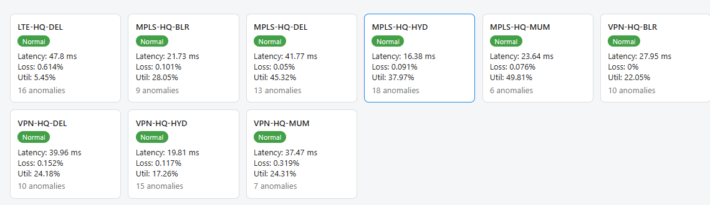
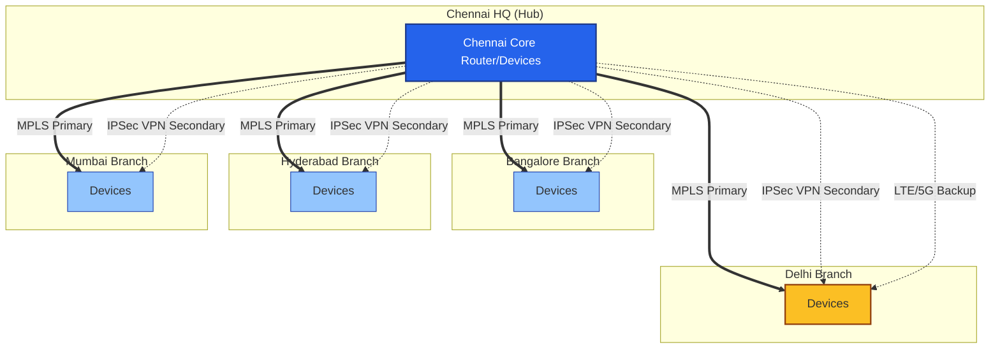
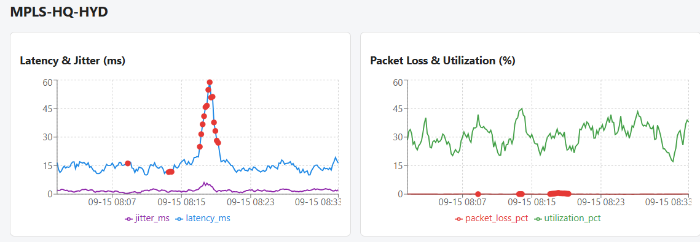
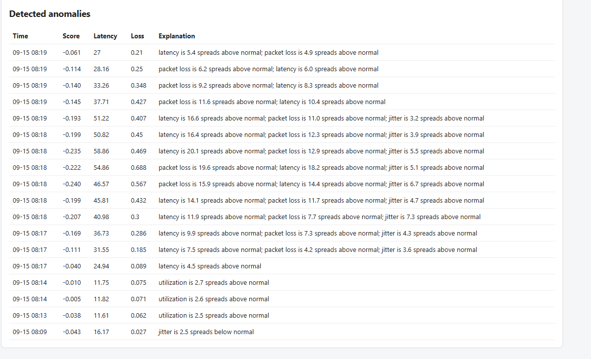

# NetSentinelWAN AI

**Explainable AI anomaly detection for enterprise SD-WAN.**

M.Tech (CSE) capstone project. NetSentinelWAN AI simulates a hub-and-spoke enterprise WAN, detects abnormal link behaviour with an Isolation Forest, and explains every flagged reading in plain English on a live dashboard.

Inspired by commercial platforms such as Cisco Catalyst SD-WAN and FortiNet Secure SD-WAN.



---

## Highlights

- **Realistic simulated WAN**: Chennai HQ plus Bangalore, Hyderabad, Mumbai and Delhi branches over MPLS (primary), IPSec VPN (secondary) and LTE/5G (backup), 9 links in total.
- **Unsupervised detection**: one Isolation Forest per link type, trained on baseline-deviation features.
- **Built-in explainability**: the same deviations that drive the model are reported back as sentences such as *"latency is 16.6 spreads above normal; packet loss is 11.0 spreads above normal"*.
- **Honest validation**: detections are stored separately from the injected anomaly schedule, so detected vs. injected can be compared directly.
- **Full stack**: Python simulator, PostgreSQL (Neon), FastAPI, scikit-learn, React.

## Simulated network topology

A hub-and-spoke WAN with Chennai as the hub. Every branch has an MPLS primary and an IPSec VPN secondary; Delhi also has an LTE/5G backup.



## Architecture

```
Telemetry simulator (Python)
        |
        v
PostgreSQL on Neon  <---------------------+
        |                                 |
        v                                 |
FastAPI backend  --->  AI engine (scikit-learn Isolation Forest)
        |                  writes flagged readings + explanations
        v                  to anomaly_detections
React dashboard (Vite + Recharts)
```

## Tech stack

| Layer | Technology |
|---|---|
| Simulator | Python |
| Database | PostgreSQL (Neon), raw SQL via psycopg |
| Backend | FastAPI, psycopg |
| AI engine | scikit-learn (Isolation Forest), pandas |
| Frontend | React (Vite), Recharts, Axios |

## Repository layout

```
.
├── backend/            FastAPI app (app/routers, app/schemas, app/database.py)
├── ai_engine/          Training, prediction, explanation, validation, persistence
├── frontend/           React dashboard
├── populate_readings.py  Generates and loads simulated telemetry and the anomaly schedule
└── docs/               topology.mermaid and README screenshots
```

## How the AI engine works

1. **Features**: percentage deviation from each link's baseline for latency, jitter and utilization; raw difference from baseline for packet loss (avoids exaggeration when the baseline is near zero).
2. **Models**: one Isolation Forest per link type (`mpls`, `ipsec_vpn`, `lte_5g_backup`), with contamination set from the known anomaly schedule.
3. **Explanations**: each feature's distance from normal is measured in robust spreads (median / MAD). The top contributors become a plain-English summary.
4. **Persistence**: flagged readings are upserted into `anomaly_detections` (keyed on `reading_id`).

### Validation

Flags were compared against the injected ground truth in `anomaly_events`:

| Link type | True anomalous readings caught |
|---|---|
| MPLS | 33 / 46 |
| IPSec VPN | 31 / 42 |
| LTE/5G backup | 13 / 16 |

Overall, roughly 72-81% of injected anomalous readings are caught per link type. Because contamination fixes the number of flags, false positives equal false negatives.

## API

Base URL: `http://localhost:8000` (interactive docs at `/docs`)

| Endpoint | Description |
|---|---|
| `GET /sites`, `/devices`, `/wan_links` | Topology |
| `GET /link_readings` | Link telemetry (filter by `link_id`, `start_time`, `end_time`, `limit`) |
| `GET /device_readings` | Device telemetry |
| `GET /anomaly_events` | Injected ground-truth anomalies |
| `GET /anomaly_detections` | Model detections joined with their readings (`link_id`, `limit`) |
| `GET /anomaly_detections/summary` | Per-link status: anomaly count and latest metrics |

## Getting started

### Prerequisites

- Python 3.10+
- Node.js 20+
- A PostgreSQL database (this project uses [Neon](https://neon.tech))

### 1. Configure the database

Create `backend/.env` (and copy it to `ai_engine/.env`):

```
DATABASE_URL=postgresql://<user>:<password>@<host>/<db>?sslmode=require
```

Create the tables, then load simulated telemetry:

```powershell
python populate_readings.py
```

### 2. Run the AI engine

```powershell
cd ai_engine
python -m venv venv
.\venv\Scripts\activate
pip install -r requirements.txt
cd ..
python -m ai_engine.train      # trains the three models
python -m ai_engine.validate   # compares flags with ground truth
python -m ai_engine.persist    # writes detections to anomaly_detections
```

### 3. Run the backend

```powershell
cd backend
python -m venv venv
.\venv\Scripts\activate
pip install -r requirements.txt
uvicorn app.main:app --reload
```

### 4. Run the dashboard

```powershell
cd frontend
npm install
npm run dev
```

Open the URL Vite prints (usually `http://localhost:5173`). The backend allows CORS from ports 5173 and 5174.

## Dashboard

### Link overview

Latest latency, loss and utilization for all 9 links, plus total anomaly counts. Click a card to drill down.


### Time-series charts

Latency and jitter, and packet loss and utilization, for the selected link, with detected anomalies marked in red. The example below shows the latency spike on MPLS-HQ-HYD being flagged.



### Explainable detections

Every flagged reading comes with its anomaly score, key metrics and a plain-English explanation.



## Design decisions

- **Raw SQL over an ORM**: keeps the data layer explicit and visible.
- **`VARCHAR` + `CHECK` over native ENUMs**: easier to evolve.
- **`NUMERIC` over `FLOAT`** for metrics: avoids precision issues.
- **Separate `anomaly_detections` table**: `anomaly_events` stays as scheduled ground truth, so validation is honest.
- **Robust-spread explanations instead of SHAP**: simple, fast and directly tied to the model's features. SHAP is a possible upgrade.
- **Simulated telemetry instead of GNS3 or SNMP**: a controlled, reproducible dataset with known ground truth.

## Limitations and future work

- Detection quality is bounded by the simulated data; real-network telemetry (SNMP, INT/eBPF) is a stretch goal.
- The dashboard badge reflects only the latest reading, so a link with recent anomalies can show "Normal".
- The AI engine reloads all readings from Postgres on every run (a batch job, not a streaming pipeline).
- Possible extensions: live scoring on ingest, SHAP-based explanations, alerting, link failover recommendations.

## Author

**Abishek**, M.Tech Computer Science and Engineering
Project guide: Mr. Yuvaraj G, Assistant Professor
